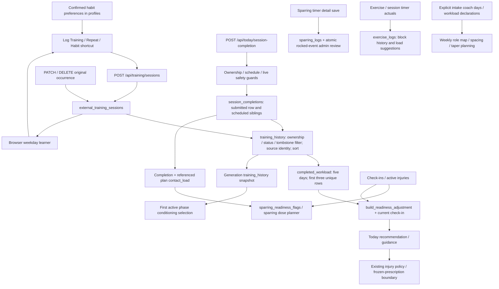

# Unified training workload and readiness integration audit

## Audit basis

Audited **Main `6428fb83dce044766966775ade07dc3abfa70315`**, including merged PRs [#2917](https://github.com/vitalvightz/unlxck-gpt-webhook/pull/2917), [#2918](https://github.com/vitalvightz/unlxck-gpt-webhook/pull/2918) and [#2919](https://github.com/vitalvightz/unlxck-gpt-webhook/pull/2919), on 18 October 2026. Findings below describe that revision, not live athlete data or deployed behaviour. Source links are relative to this report. Function names identify the relevant implementation precisely.

This PR adds this report and deterministic audit characterizations in [test_unified_workload_audit.py](../../tests/test_unified_workload_audit.py). Production code, policies, thresholds, prescriptions, dependencies and schemas are unchanged. Tests marked `audit` characterize defects/limitations as they exist; passing those assertions is **not** acceptance of that behaviour. Fix PRs must replace those characterizations with the agreed invariant.

## A. Executive summary

**Unlxck recognizes separately stored prescribed and manual workouts on the same day, but does not yet provide one reliable interpretation of every physical workout.** Two manual saves with different request keys remain separate, and a prescribed completion plus a manual Boxing/Sparring log reaches the shared readiness engine. Matching names or dates are not merged. Manual Hard remains a qualitative demanding-session signal, never RPE 8 or confirmed head contact.

The most significant correctness mismatch is between **day-level prescribed completion** and **session-level workload**. One completion submission is persisted to every eligible scheduled sibling that day, including a breathing reset. History and workload subsequently count those rows as separate workouts with the same RPE. A second submission can overwrite the first session's RPE. Thus two prescribed rows do not necessarily mean two completed workouts.

Manual saves, edits and tombstone deletion re-evaluate an existing Today check-in on a fresh Today request. Plans and stored check-ins are preserved; cache invalidation works. However, this refresh is gated by recent manual records: new **prescribed-only** work can leave the stored recommendation stale. Generation also incorrectly labels its combined workload history available when its prescribed-completion read failed, although its separate contact-risk path records that failure.

The three-session cap demonstrably discards relevant information: three recent Easy sessions hide two Hard sessions still inside five days. A clean SPP check-in then produces green rather than the existing `recent_hard_session` modification. This establishes sensitivity and information loss, **not** clinical evidence that an uncapped five-day rule is the correct replacement. The cap is a policy decision requiring validation before changing it.

External work has a deliberately narrow generation effect: with a same-day check-in and the existing repeated-hard-work trigger, it can raise **first active phase conditioning-selection fatigue** from low/none to moderate. It does not directly change strength, weekly allocations, hard-day spacing, phase lengths or taper. Manual Hard Sparring cannot alter contact permissions. Explicit sparring details, including reported head contact/rocked events, live in a separate history/review path and currently do not update readiness or programme contact-load calculations.

No verified P0 medical-policy bypass was found. The P1 issues below affect evidence correctness and consistent decisions. The audit cannot establish physiological safety of repeated-session thresholds; it confirms their deterministic behaviour and preservation of existing injury/neurological precedence in the exercised paths.

### Answers to the seven completion questions

1. **Two separate same-day workouts?** Yes for independently persisted occurrences; prescribed write fan-out prevents a general guarantee for two app sessions (F1).
2. **Can one workout count twice?** Yes through prescribed fan-out, or when the athlete records the same workout manually and as prescribed. Source-scoped deduplication cannot reconcile physical overlap (F1/F9).
3. **Actual training after save/edit/delete?** Manual work reliably refreshes on the next canonical Today read when an existing check-in and recent row/tombstone are available. Prescribed-only changes lack equivalent re-evaluation (F2); saturated reads are an exception (F7).
4. **Five days/three sessions lose meaningful information?** Yes: counts, known minutes and demanding sessions outside the first three disappear; a deterministic recommendation can change (F4).
5. **Which generation consumers use manual work?** First-phase conditioning selection only, under explicit gates. No direct strength/allocation/spacing/taper/contact/rehab consumer (F6).
6. **Are safety/completion boundaries preserved?** Manual effort does not authorize contact, award prescribed XP, become rehab evidence, or rewrite saved prescriptions. Current neurological/injury restrictions remain separate authorities. Fan-out undermines the accuracy of prescribed completion evidence (F1); explicit sparring reports remain disconnected (F5).
7. **Smallest justified sequence?** Correct occurrence provenance and preserve sibling actuals; refresh both sources consistently; fix availability propagation; validate the cap and complete-history contract; then add evidence transparency. Contact and future-calendar expansion require separate product/policy decisions (section F).

## B. Actual data-flow map



There is no arrow from `sparring_logs`, `exercise_logs`, timer local storage or habit confirmation to `completed_workload`. No manual mutation directly regenerates a plan.

### Call chains and authoritative storage

- **Manual:** [log-training.tsx](../../web/components/log-training.tsx), `startEdit`/`save` → `logExternalTraining`/`editExternalTraining` → [today.py](../../api/routes/today.py), `log_external_training`/`edit_external_training`/`remove_external_training` → [training_history.py](../../api/services/training_history.py), `create_external_training`/`update_external_training`/`delete_external_training` → [store.py](../../api/store.py), `create_external_training_session`/`update_external_training_session`/`delete_external_training_session`. `external_training_sessions` is authoritative. Delete is a tombstone, not another completion source.
- **Prescribed:** `today.py` completion route → [today_readiness_boundary_core.py](../../api/services/today_readiness_boundary_core.py), `upsert_session_completion` → [today_service.py](../../api/services/today_service.py), `upsert_session_completion` → `AppStore.upsert_session_completion`. Authoritative table is `session_completions`; the service's sibling loop is important, not just the row returned by the route. DB upsert identity is `(athlete_id, session_id, training_day)`; service rejects rebinding to another plan. Source history adds `plan_id` to its key. Resetting a completion to an uncompleted status excludes it from workload. The [completion table migration](../../supabase/migrations/20260618120000_add_today_checkins_and_completions.sql) gives `plan_id` an `ON DELETE CASCADE` relationship: prescribed evidence has a different deletion lifecycle from independent manual history. No live deletion/cascade was exercised.
- **Today evaluation:** `submit_today_checkin` → `_readiness_decision_with_failsafe` → `_readiness_context_and_status` → `training_history` → [readiness_message.py](../../api/contracts/readiness_message.py), `_recent_hard_session_count` → [completed_workload.py](../../fightcamp/completed_workload.py), `completed_workload` → `build_readiness_adjustment`. Stored recommendation lives on `today_checkins`. Read-time manual refresh in `_build_today_command_view` reconstructs the original check-in including its safety booleans and evaluates current evidence; it replaces only the response recommendation.
- **Safety/read failures:** [today_readiness_boundary.py](../../api/services/today_readiness_boundary.py), `build_today_command_view` synchronizes intake injuries and wraps one build in `_BuildReadCache`; core `_ReadinessTrackingStore` records failed reads. [readiness_failsafe.py](../../api/services/readiness_failsafe.py), `apply_context_failsafe` applies the existing degraded/unavailable floor. Injury reconciliation and frozen prescriptions remain their existing owners. This request-local cache is distinct from the 30-second XP command-view cache.
- **Generation:** [orchestrator.py](../../api/generation/orchestrator.py), generation workflow calls [sparring_readiness_snapshot.py](../../api/services/sparring_readiness_snapshot.py), `annotate_payload_with_sparring_readiness` in health mode → `PlanInput.from_payload` → `build_runtime_context` → [plan_pipeline_blocks.py](../../fightcamp/plan_pipeline_blocks.py), `_generate_conditioning_blocks`. The separate prescribed-only `context.sessions` → `_contact_load` → [sparring_readiness.py](../../fightcamp/sparring_readiness.py), `sparring_readiness_flags` → `build_athlete_model`/`sparring_dose_planner.hard_sparring_risk_state`. Non-health generation intentionally does not attach this health snapshot.
- **Exercise details:** `today.py`, `submit_exercise_log`/`submit_exercise_logs` → [exercise_log_service.py](../../api/services/exercise_log_service.py), `record_exercise_log`/`record_exercise_logs` → `exercise_logs`. Block actuals are correction-upserted by `(athlete_id, plan_id, training_day, block_id)`; session identity is server-resolved. `exercise_history_context` supports recent performances/loads returned to the logging UI, not session workload or Stage 1 strength selection.
- **Sparring details:** `today.py`, `submit_sparring_log` → `AppStore.record_sparring_log` → SQL `public.record_sparring_log` in [the sparring migration](../../supabase/migrations/20260930141404_add_sparring_logs.sql). `sparring_logs` holds actual reported intensity/rounds/head contact; a rocked report atomically creates `admin_reviews`. `list_sparring_log_history` computes 7-/28-day summaries. Those reads are absent from Today/generation readiness assembly.
- **Timer:** [round-timer-provider.tsx](../../web/components/session-timer/round-timer-provider.tsx) and `use-session-timer.ts` store resumable activity locally. [today-session-panel.tsx](../../web/components/today/today-session-panel.tsx) hands session timer results to `timerExerciseLogs` and session review; contact runs can open `SparringLogPrompt`. Running/finishing a timer alone is not server-owned completion. Plain round activity is not a workout ledger entry.
- **Habits:** [training-habits.ts](../../web/lib/training-habits.ts), `learnTrainingHabits` consumes manual history; [training-habit-log.tsx](../../web/components/training-habit-log.tsx), `persist` saves `profiles.training_habits` with revision comparison. Only the subsequent `LogTraining.save` creates actual work.

### PR-specific verification

`git show dd4c8b12`, `880d5d8a` and `6428fb83` plus their current call sites were inspected. #2917 repeats eligible manual history through the existing creation API, resets date/effort and uses a fresh key per new save. Unchanged failed submissions retain the key; a synchronous ref prevents double submit. #2918 adds deterministic browser learning and profile preferences, not training completions or planner scheduling. #2919 changes shared capture controls; History edit PATCHes the original ID and retains its date. Their successful UI tests do not prove backend readiness integration by themselves; the backend chains/tests above do.

## C. Integration matrix

`Yes*` means only under the existing five-day/three-row classification and/or refresh gates. `None` means no direct consumer found in the traced deterministic paths, not an assertion about all possible analytics.

| Source and authority | Actual or planned | Workload / Today | Future generation | Contact / injury / XP / rehab | Identity and training day |
| --- | --- | --- | --- | --- | --- |
| Done Unlxck: `session_completions` | Actual declaration, **day fan-out caveat** | Yes* / check-in evaluation; prescribed-only refresh gap | General history for conditioning; prescribed contact/fatigue evidence | Plan-derived contact proxy; post-session pain injury signal; prescribed route owns XP/rehab follow-up | DB row UUID; athlete/session/day unique; plan mismatch rejected; server local day or validated retro day |
| Modified Unlxck: same table | Actual declaration, not full prescribed dose | Yes*, demanding via RPE/pain | Same history; `_contact_load` conservatively treats modified hard contact as reduced | Existing completion/rehab response semantics apply; not proof of full dose | Same occurrence; modification reason required; completed timestamp retained on retry |
| Manual coach-led training: `external_training_sessions` | Actual athlete report | Yes*; Hard requires valid minutes; read-time refresh with check-in | First-phase conditioning only under F6 gates | No contact inference; no new injury flag, prescribed XP or rehab evidence | Row UUID + athlete/request UUID; source `external`; plan null; local day stored |
| Repeat manual save: same table | New actual report only after Save | Same as manual; two same-day keys count twice | Same | Same | New request key per new occurrence; retry same key returns existing row |
| Learned weekday suggestion: browser projection | Prediction/logging shortcut | None until saved | None | Cannot clear restrictions or award evidence | Based on distinct activity/date observations; no workout ID |
| Confirmed habit: `profiles.training_habits` | Logging preference, **not scheduled commitment** | None until saved | None | Safety gate controls suggestion visibility; no clearance | Weekday/activity preference + profile revision; no occurrence |
| Explicit coach-day intake declarations | Planned obligation/context | Not completed workload | Yes: hard/support/technical days inform calendar/role allocation and existing sparring constraints | Existing injury/contact policy still controls effective work | Intake weekday fields; resolved schedule sessions gain prescribed IDs |
| Exercise actuals: `exercise_logs` | Actual per-block report, not whole workout | No additive session workload | No actual-work input to Stage 1 strength; UI recent-load/progression support | No standalone completion XP/rehab credit; existing completion response remains necessary | Athlete/plan/day/block correction key; session and day server-resolved |
| Sparring detail: `sparring_logs` | Actual reported rounds/intensity/contact | None | None | Explicit reported contact in History; rocked notice/admin review; no automatic readiness/clearance/rehab transition | Fresh DB UUID each POST; optional session/plan; local day; no idempotency key |
| Round/session timer local state | In-progress tool activity | None by itself | None | No standalone XP, rehab or clearance | Local run key; session/contact runs scoped to plan/session/day; plain timer is free activity |
| Planned / not_started / started / skipped | Planned/uncompleted (skipped is historical non-completion) | Excluded, even with high RPE; skipped can appear in History | No completed load; excluded from contact readiness | No completed-work proof; start may freeze accepted prescription | Existing completion identity; status/timestamps distinguish execution state |
| Edited / deleted manual occurrence | Corrected actual / tombstoned report | Edit replaces effort/minutes; deletion removes load; tombstone triggers Today refresh | Next generation re-reads corrected history | No prescribed or clinical mutation | ID/date remain; date cannot be PATCHed; tombstone blocks late POST resurrection |

Inferred preferences never become coach commitments. Already-declared `hard_sparring_days`, `support_work_days` and legacy `technical_skill_days` are the existing route for planned coach obligations. Calendar integration of an explicitly confirmed obligation is feasible through that architecture, but a habit's “Yes, usually” is not that consent.

### What `completed_workload` actually measures

1. It excludes explicit non-`done`/`modified` statuses and tombstones. Missing status is intentionally treated as done for legacy pure-engine inputs; persisted history already filters statuses.
2. For a valid `as_of`, it admits dates with `0 <= age < days`: default five dates including today. Future, stale and invalid dates are excluded. Backdated records use **training day**, not submission date.
3. Identity is `(source defaulting to unlxck, id or session_id or input index, plan_id, training_day)`. Repeated copies of the same keyed row collapse. Different sources and different IDs remain distinct. Repeating identical conflicting copies is last-value-wins, not conflict reconciliation; row order is first-insertion order.
4. It takes the **first three** unique eligible rows, without sorting. Production Today and conditioning inputs pass through `training_history`, which sorts by training day, completion/creation timestamp, then ID descending. Generation `recent_rows` and field projection retain that order. No current production call with unsorted combined history was found. Pure callers have no enforced ordering contract; prescribed DB retrieval has no same-day timestamp/ID tie-break before its limit.
5. `sessions` counts selected rows, not distinct training dates. `actual_minutes` sums only integer 1–600 `duration_minutes`; bool, float, string, missing or invalid values add zero. `hard_minutes` is the subset of these known minutes from demanding rows. Prescribed completion accepts RPE/pain but has **no recorded duration field**, so its unknown duration adds zero. This is honest known-time arithmetic, but zero must not be presented as proof of zero elapsed time. Timer work/rest or start/end timestamp differences are not imported or estimated.
6. External `effort == hard` counts as demanding only with valid minutes. Prescribed demanding means `int(session_rpe or rpe) >= 8` or `int(pain_after) >= 6`. Production contracts bound numeric fields; no Hard→RPE or duration→fatigue conversion occurs. Validated effort/correction belongs to its original occurrence.

Keep these concepts separate: **session count** (completed physical workouts, currently approximated by rows), **training days** (distinct dates, not returned), **known duration** (validated recorded minutes), **demanding sessions** (existing classifications), and **contact exposure** (separate evidence). Habit learning intentionally collapses activity/date observations; workload does not. Plan-derived `contact_load` is evidence of a reported completed prescribed contact session, **not verified head-impact measurement**. Explicit head-contact reports exist in `sparring_logs` but are not consumed by these rules.

Invalid `as_of` silently disables the date filter. Current production callers resolve valid dates; this is a helper-contract limitation, not a reproduced production false-green incident. Database/history saturation is described in F7. Do not describe the returned counters as five-day totals without disclosing the three-row selection.

## D. Same-day scenario results

Evidence labels: **existing** = reused tests in [test_external_training.py](../../tests/test_external_training.py) unless named otherwise; **audit** = the new audit test module. These are local deterministic results, not live deployment trials.

| Scenario | Result | Evidence / qualification |
| --- | --- | --- |
| Unlxck Strength + separate manual Boxing | Pass for independent stored occurrences | Existing `test_no_double_counting_or_rehab_xp_side_effects`; audit `test_separately_stored_same_day_occurrences_remain_two[mixed]`. Both sources survive; no name/date merge. |
| Unlxck Conditioning + manual Hard Sparring | Pass with scope limit | Audit mixed-occurrence and known-duration tests; existing `test_sixty_minutes_hard_sparring_reaches_both_paths_without_rpe_or_contact_inference`. Both workload records survive, manual contact is not inferred. |
| Two manual sessions on one day | Pass | Separate UUIDs/keys, two counts; existing creation/retry tests; audit `...[manual]`. One training day, two demanding sessions. |
| Two completed Unlxck sessions | **Fail for independent completion reporting** | Audit `test_audit_one_submission_fans_out_and_becomes_two_demanding_workouts` and `test_audit_second_prescribed_submission_overwrites_first_sessions_rpe`. Independently seeded rows count correctly (`...[prescribed]`), but actual write path couples them (F1). |
| Same physical workout logged in both systems | Reconciliation gap; deliberate no guessed merge | Combined source identities count twice even if labels/date match. Existing mixed-history test proves storage separation; no physical-overlap field/UI found (F9). |
| Manual work before scheduled Unlxck session | Pass with existing check-in | Existing read-time refresh test and audit mixed trigger test: new repeated-demanding evidence reaches displayed recommendation. Without a check-in, ordinary manual work does not manufacture readiness. No automatic dose mutation of the saved plan. |
| Manual work after Unlxck completion | Boundary preserved | Manual writes touch only external table; read-time refresh does not persist plan/check-in/completion changes. `_build_today_command_view` passes no completed training session to `reconcile_session_prescription`; next/future entry remains separate. Audit `test_manual_after_completion_preserves_accepted_prescription_and_history` preserves an accepted snapshot and completion; no full browser injury/frozen-session replay added. |
| Manual Hard changed to Easy | Pass within read bounds | Existing `test_edit_and_delete_remove_hard_work_from_both_adaptive_inputs`; audit `test_manual_edit_delete_recompute_display_without_rewriting_history` removes the displayed Heavy recent load trigger. |
| Manual deleted | Pass within read bounds | Tombstone excluded from history, retained in refresh probe; existing delayed-retry/delete and read-time refresh tests. Audit confirms display recomputation. |
| Learned/confirmed session not saved | Pass | `learnTrainingHabits`/preference write cannot create completion; existing habit preference tests and frontend learner tests. |
| Started or skipped app session | Pass for completed workload | Existing `test_planned_or_uncompleted_work_never_counts` and skipped-history test. Status filtering occurs before workload cap. |
| Manual Hard Sparring interpreted as head contact | Pass: never inferred | Manual session omitted from prescribed contact stream; no RPE synthesized. Existing snapshot/flags tests. This does **not** establish that actual contact was absent. |
| Two demanding sessions + current poor check-in | Pass: rule activates | Audit same-day tests and existing repeated-workload test activate `recent_hard_load_plus_poor_today`. Dates need not be different. |
| Three Easy sessions follow two Hard within five days | Information loss demonstrated | Audit cap/history tests; latest-three counter becomes 0 demanding despite two in the window (F4). |

Two demanding workouts alone are **not a universal stop or reduction rule**. `_soft_warning_state` uses `recent_hard_count >= 2`; poor current readiness adds `recent_hard_load_plus_poor_today`. In SPP/TAPER/REINTEGRATION, repeated hard evidence can also add `recent_hard_session` without poor current readiness. GPP with a clean check-in can stay green. Same-day counting is explicit session counting; the code does not require recovery days between observations. This is intentional deterministic behaviour. Its physiological calibration requires validation, and F1 means its premise can currently be false.

### Save, refresh, guidance and preservation

Manual Save → existing API/store mutation → history projection → Today `refresh()` (`TrainingHabitLog.onSaved` in `today-screen.tsx`) → `getToday` → canonical boundary → recent manual/tombstone probe → re-evaluate stored check-in → workload → current response recommendation. `use-today-command.refresh` sets the returned state before ancillary presentation fetches. History edits/deletion update its local list; the **next Today GET** re-evaluates. This is request-driven, not a server push to an already-open second tab.

`api.app.invalidate_athlete_read_caches` drops the athlete's derived command cache after non-neutral mutations, including POST/PATCH/DELETE training. `GET /api/today` always builds fresh; [today_command_cache.py](../../api/services/today_command_cache.py) is reuse for downstream XP progress, not a stored Today API response. Existing `test_each_manual_mutation_invalidates_existing_today_cache` covers all three methods. No distributed cross-worker invalidation was verified; the registry is process-local and expires after 30 seconds by default. Fresh Today remains authoritative even in that limitation.

New evidence re-runs the same check-in, including neurological and pain booleans. Injury/medical holds and the boundary's incomplete-context floor still apply. Audit tests preserve neurological STOP; existing readiness/boundary tests cover severe injury, unavailable safety context and frozen work. A new workload signal cannot outrank those holds. An edit/deletion can legitimately remove a workload restriction; it must not remove independently active injury/contact restrictions. Completed or accepted prescriptions are not rewritten by manual records. The separate prescribed sibling loop already overwrites sibling *completion actuals* (F1), so immutability must not be overstated across all completion operations.

## E. Ranked findings

### P0

No confirmed P0 policy bypass in this audit. The explicit-contact gap below merits safety-owner review; the existing code intentionally creates a review/notice rather than an automatic medical-policy transition.

### F1 — P1 confirmed defect: day completion fan-out is counted as independent workouts

- **Exact location/call chain:** `today_service.upsert_session_completion`, scheduled sibling loop after the first `store.upsert_session_completion` (around lines 1554–1586) → `training_history.training_history` → `completed_workload.completed_workload`; generation also uses those completions in `_contact_load`/`sparring_readiness_flags`.
- **Reproduction/observed:** schedule Conditioning + Breathing reset, submit Conditioning done/RPE 8 once. Two done rows receive RPE 8; workload reports two demanding sessions and fires the repeated-load trigger with flat current readiness. Submit Conditioning/RPE 6 then Strength/RPE 9: both stored RPEs become 9. A scheduled sparring sibling can likewise become a completed contact proxy without separate confirmation; that contact consequence follows the code chain but was not independently exercised by the new regression.
- **Expected/justification:** one real completion contributes once; genuine separate sessions retain independently reported actuals. Existing intentional day-level UX is not sufficient provenance for a session-level count. Never deduplicate all same-day sessions to solve this.
- **Coverage/Main:** reproduced on the audited Main production service by the two named audit tests. Existing optional-completion tests protect exclusion of optional visualisation, not workload multiplicity; existing completion/XP tests mostly test day credit or direct store rows.
- **Impact/smallest fix:** false workload and potentially misleading prescribed contact/fatigue history; independent feedback is lost. First establish explicit occurrence provenance using the existing completion architecture. If keeping day-level submission, projection must know which rows belong to one execution; if adopting independent submissions, update the fan-out owner and its UI contract narrowly. Current rows have no trustworthy grouping marker; matching timestamps/title/date is not a safe repair. Do not rewrite historical data or change XP/rehab/day-credit policies as an incidental fix.

### F2 — P1 confirmed defect: prescribed-only new evidence can leave Today stale

- **Location/chain:** `today_service._build_today_command_view`, `recent_manual_work` gate (around 3136–3158), after `_recommendation_mapping(today_checkin)` → stored response; engine itself correctly consumes prescribed records when called.
- **Reproduction/observed:** store a flat same-day check-in with a green recommendation, then add two prescribed done/RPE-8 occurrences (including the rows produced by F1). Fresh canonical Today lacks Heavy recent load. Direct engine evaluation includes it. Add one Easy manual record: identical prescribed evidence now activates the refresh and displayed trigger.
- **Expected:** both authoritative actual-work sources re-evaluate the current check-in consistently. A previously stored recommendation must not hide new completion evidence. This test isolates downstream refresh using store writes; F1 separately exercises the real completion writer, which has no post-write recommendation recomputation.
- **Coverage/Main:** audit `test_audit_prescribed_only_new_work_does_not_refresh_stored_recommendation` reproduces on Main. Existing read-time test covers manual creation/deletion only.
- **Impact/fix:** stale remaining-work guidance after app work. Reuse `_readiness_decision_with_failsafe` on fresh Today for both sources or a source-neutral evidence-change gate. Preserve original check-in history, completed/frozen prescriptions, independent medical restrictions, and not-checked-in semantics.

### F3 — P1 confirmed defect: generation workload availability can conceal a failed source

- **Location/chain:** `sparring_readiness_snapshot.annotate_payload_with_sparring_readiness`, nested `read`, `completions`, and `history_input.available` → `training_history(... prescribed=completions)` → conditioning gate.
- **Reproduction/observed:** `list_session_completions` throws; `read` records `unavailable` and returns `[]`. `training_history` succeeds with that supplied empty prescribed list plus manual rows. `training_history.available` remains true, despite missing half its authoritative evidence. Contact flags correctly include `sparring_history_unavailable`.
- **Expected:** combined workload availability must inherit failure of either constituent source. Empty new-athlete history and failed history are different facts.
- **Coverage/Main:** audit `test_audit_generation_completion_failure_marks_contact_but_not_workload_unavailable`; existing external-outage test covers the opposite source. Reproduces on Main.
- **Impact/fix:** conditioning may use a partial snapshot or miss a trigger. No demonstrated contact clearance relaxation: that stream retains failure. Propagate existing component health into combined availability; retain existing conservative contact handling. Whether conditioning should adopt any additional fallback on missing history is a separate policy decision, not a threshold fix.

### F4 — P1 product decision requiring validation: the latest-three rule is not a five-day total

- **Location/chain:** `completed_workload`, `recent = list(unique.values())[:limit]` → `readiness_message._recent_hard_session_count` and generation conditioning's same engine.
- **Reproduction/observed:** Hard on Oct 6/7, Easy on Oct 8/9/10, `as_of=Oct 10`. Sorted real history contains all five. Default returns 3 sessions/0 demanding; `limit=None` returns 5/2. Clean SPP is green with those latest three; putting the Hard entries first in the pure helper makes the existing engine modify. Three Easy sessions later the **same day** can similarly displace earlier hard work if their creation timestamps are later.
- **Expected/justification:** the cap must be named as a latest-session sampling policy. If the product promise is total relevant five-day workload, this conflicts with it. The audit does not assert an uncapped calculation is medically superior or authorize changing the rule.
- **Coverage/Main:** audit cap/order and real-history tests; pre-existing repeated-load tests stay below the cap. Main reproduces the information loss and a changed decision.
- **Impact/smallest next step:** high-frequency athletes can lose recent demanding evidence and known minutes. Validate the intended sampling rule with explicit examples first. Keep thresholds/formula unchanged in the correctness PRs. Only a separately approved policy change should alter selection/cap; evidence totals and rule inputs can be exposed separately without pretending they are interchangeable.

### F5 — P1 missing integration, with intentional safety boundary: sparring actuals do not drive decisions

- **Location/chain:** `today.submit_sparring_log` → `AppStore.record_sparring_log`/SQL → history/review; compare absence of `list_sparring_logs` in Today readiness/snapshot assembly. `sparring_readiness_flags` consumes plan-annotated prescribed completions and check-ins instead.
- **Reproduction/observed:** save explicit head contact/rocked detail: it persists and queues review/notice but does not change Today readiness or completed workload. A timer-only sparring workout absent manual/prescribed completion contributes no session. `test_rocked_does_not_change_todays_readiness` explicitly locks current behaviour.
- **Expected/justification:** logging detail must not silently be advertised as updating readiness. Whether explicit contact evidence should drive additional restrictions requires the policy owner; deriving contact from manual Hard would be an unsafe substitute.
- **Coverage/Main:** existing API sparring tests verify actual route/atomic failure path; call-chain absence verified on Main. The unfulfilled integration is confirmed; a claim that existing medical policy mandates an automatic hold here is **unverified**.
- **Impact/fix:** incomplete workload/contact awareness for athletes using this logging route alone. First document exactly what each save affects and decide event linkage/clinical ownership. Then consider an explicitly linked server-owned evidence adapter, with a new session only when a workout identity is actually confirmed. Preserve atomic reviews, distinct events and current clearance requirements; do not double-add detail and completion rows.

### F6 — P1 product decision requiring validation: external work only changes first-phase conditioning

- **Location/chain:** `plan_pipeline_blocks._generate_conditioning_blocks` reads `sparring_readiness.training_history`; `_generate_strength_blocks` does not interpret it. `build_runtime_context` initializes fatigue from `PlanInput.fatigue`; `allocate_sessions`, `stage2_planning_brief._build_phase_briefs`/`_cap_session_counts_to_frequency`, `stage2_role_map` and sparring dose logic use intake, calendar, injuries and their existing risk inputs.
- **Observed gates:** combined history available; any recent external row; a same-day check-in; the existing `recent_hard_load_plus_poor_today` trigger; decision modify/pull_back; base fatigue low/none. Only first active phase's conditioning flags become moderate. A clean/stale/missing check-in does not activate this adapter. “Recent” snapshot rows initially cover seven dates; the reused workload engine narrows its own evidence to five.
- **Expected/justification:** current scope is explicit in implementation and protects strength, contact and coach commitments from ad hoc historical rewriting. It is a confirmed limited integration, not proof every future session should adapt. External fatigue and confirmed head contact are different dimensions; excluding one must not be justified by conflating them.
- **Coverage/Main:** existing repeated-workload selector-capture test checks first phase moderate, later phases low, global fatigue/phase lengths unchanged, and no contact inference. Main code search finds no other `training_history` consumer in `fightcamp`.
- **Impact/fix:** generation cannot claim to allocate around total recent external work. Regeneration obtains a new snapshot, but saved plans are not reactively changed. `custom_plans.custom_open_plan_result` compiles saved athlete doses without selection/history; live Today guards still apply. Validate each additional consumer separately; prefer scope disclosure first, with no broad replanning change.

### F7 — P2 product limitation: bounded history can silently be incomplete

- **Location/chain:** `AppStore.list_session_completions`/`list_external_training_sessions` → `training_history` (default 200 per source), status filtering **after** prescribed retrieval; `today_service` manual refresh probe also defaults to 200 including tombstones.
- **Reproduction/observed:** 200 newer started prescribed rows hide two done/RPE-8 rows from yesterday; history returns empty while a 202-row read returns both. No read exception or completeness flag is emitted. This is an extreme deterministic saturation case, not evidence that ordinary two-a-day athletes reach the 200 limit. History endpoint additionally returns only requested 30–200 merged rows; repeat shortcut's 30 rows are display evidence, not readiness's default 200.
- **Expected/coverage/Main:** decision evidence should signal saturation or use a bounded-by-date authoritative query. Audit `test_audit_truncation_before_status_filter_can_hide_all_completed_work` reproduces on Main. Habits already suspend inference at 200/history failure, but readiness does not share that safeguard.
- **Impact/fix:** partial history can look like no work without invoking the conservative floor. Add a date/status-bounded read or explicit completeness signal using existing store/history architecture; preserve ownership and tombstones. Prescribed DB ordering lacks a same-day tie-break at the retrieval boundary, which matters under saturation. Do not simply increase limits without defining completeness.

### F8 — P2 missing integration: explanation codes cannot identify contributing occurrences

- **Location/chain:** `completed_workload` returns four aggregate counters; `ReadinessAdjustment.triggers` → `trigger_labels`/`decision_sources` → command-view recommendation labels/sources. Stored `today_checkins.recommendation_triggers` has no contributing ID snapshot.
- **Observed/expected:** the server can truthfully say “Heavy recent load” plus current-check-in context when the corresponding trigger fires. It cannot provide a durable, exact list of the two sessions from those triggers alone. History can be re-read but may have been edited/deleted/capped differently since evaluation. No arbitrary confidence or medical causal claim is warranted.
- **Coverage/Main/impact:** aggregate/trigger assertions exist; no evidence projection test exists. Main source confirms missing identity return. Athlete/reviewer explanations cannot audit exactly which rows fired a decision.
- **Smallest fix:** optional ephemeral server-owned evidence projection emitted by the same computation: source/occurrence IDs and dates, demanding basis, selected/capped scope, known minutes and completeness. It must distinguish current response evidence from historical stored decisions. Until F1 is resolved, say “records”, not a guaranteed count of physical workouts. No new ledger/table or medical explanation generator is needed.

### F9 — P2 product decision requiring validation: user-reported overlap has no reconciliation path

- **Location/chain:** source-scoped keys in `training_history` and `completed_workload`; UI manual form accepts no prescribed occurrence link.
- **Reproduction/observed:** complete Strength then manually log that same physical session with a fresh key. Both valid rows count; two genuinely independent workouts with identical fields also count. No algorithm can distinguish these from date/activity/title alone.
- **Expected/coverage/Main:** preserving independent events is correct; explicit athlete correction is necessary for overlap. Existing mixed-history and audit source-identity tests confirm Main counts two, not that they describe two physical events.
- **Impact/fix:** accidental double reporting can trigger readiness reductions. Current smallest recovery is delete the mistaken manual row (tombstone/retry protection already works). Any later “already logged as prescribed” reconciliation must be explicit and ownership-checked, preserve actual history, and avoid guessed merging or a duplicate history table.

### F10 — P2 confirmed persistence limitation: sparring retries have no event idempotency

- **Location/chain:** `SparringLogPrompt.save` → `SparringLogRequest` (no request key) → `AppStore.record_sparring_log` → SQL always inserts a new random UUID. Store `_run_with_transient_retry` can repeat the RPC.
- **Reproduction/observed:** repeating an identical POST persists another detail log and, if rocked, another review. Existing `test_each_rocked_report_is_reviewed_even_with_a_pending_review` confirms two accepted reports remain distinct. A committed RPC whose response is lost can consequently be inserted again; the response-loss-at-DB case is code-supported, not simulated against Postgres in this audit.
- **Expected/justification:** two intentional head-impact events must remain separate; retrying the same identified event should be idempotent. The API currently has no way to express that distinction. This is a database-duplicate risk, **not current completed-workload double counting**, since these rows are not consumed there.
- **Impact/fix/Main:** duplicate History exposure summaries/reviews; confirmed lack of event identity on Main. Add explicit event request identity only in a separate narrow persistence PR, reusing existing log/RPC architecture after determining compatible atomic storage. Do not deduplicate by day, intensity, timestamp proximity or existing pending review. No schema/RPC change is part of this audit.

### Ordering hypothesis (not a confirmed production defect)

`completed_workload` is order-sensitive and does not enforce its own “recent” contract. Audit permutation test proves different pure-engine decisions for the same set. **All identified production combined-history callers currently sort first**, so a present-day unsorted production call is unverified. Document/enforce the input contract or sort at the shared projection boundary in a follow-up; do not report an actual oldest-three production selection without a failing call site. Missing IDs fall back to input index and cannot provide robust deduplication, but persisted authoritative records have IDs; no production missing-ID duplication was reproduced.

### Duplicate taxonomy

| Type | Confirmed state | Smallest safe response |
| --- | --- | --- |
| Database duplicate manual POST | Prevented for same athlete/request key; fingerprint conflict 409; tombstone replay 410 | Retain existing unique key, retry fingerprint and tombstone semantics |
| Database duplicate prescribed retry | Same athlete/session/day upsert; service rejects plan mismatch | Retain identity; fix sibling evidence separately |
| Database duplicate sparring retry | No request identity (F10) | Explicit event idempotency; distinct events still create distinct reviews |
| Projection duplicate of repeated identical history row | Source/ID/plan/day collapses it | Retain exact identity deduplication |
| One prescribed submission projected as multiple physical workouts | Fan-out rows have distinct IDs, so deduplication cannot detect it (F1) | Correct occurrence provenance at write/projection boundary |
| Exercise details plus their completion | Not added to workload; correct separation | Preserve block correction key; never count each block as a workout |
| Sparring details plus completion/manual row | Currently no additive workload; linkage unresolved | Require explicit linkage before integrating details |
| Two records describe one real workout | Cannot be inferred (F9) | Athlete-confirmed correction/removal; never fuzzy merge |

## F. Recommended follow-up PR sequence

These are proposed scopes, not implementation approval for policy changes. Correctness and evidence provenance come before expanding consumers. Each PR should have one independently testable invariant; none should silently change readiness thresholds, medical/contact clearance, rehab policy or production historical prescriptions.

| PR | Objective and exact scope / reused architecture | Acceptance tests | Dependencies, safety constraints and what stays unchanged |
| --- | --- | --- | --- |
| 1. Prescribed execution provenance | Resolve F1 at `today_service.upsert_session_completion` and history projection. Decide whether one submission represents one day execution or independent session execution; preserve sibling actuals. Reuse `session_completions` and existing day-credit identity. Inspect existing persisted fields before choosing a compatible provenance representation; report any schema need separately. | One Conditioning + reset submission is one real workload event; two confirmed sessions same day remain two; second submission never rewrites first RPE/pain; retry stable; no phantom completed contact; optional visualisation unchanged. | First implementation priority. No guessed historical grouping, data rewrite, fuzzy merge or duplicate ledger. Keep XP/day credit, rehab response ownership and accepted prescription invariants; any required UX/contract change must be explicitly scoped. |
| 2. Source-neutral Today refresh | Resolve F2 through canonical `_readiness_decision_with_failsafe` on current authoritative evidence for an existing check-in. Reuse fresh Today build and mutation invalidation; preserve response-only recalculation. | App-only completion after check-in changes trigger; manual before/after app completion; Hard→Easy, delete, not_started/skipped; severe injury and neurological STOP unchanged; completed/frozen prescription byte-for-byte preserved. | Can develop independently but final occurrence-count acceptance depends on PR1. No check-in fabrication, retrospective prescription mutation or medical hold relaxation. |
| 3. Snapshot completeness | Resolve F3 by inheriting existing failed component reads into combined history health. Reuse snapshot `available`/`unavailable` and Today fail-safe vocabulary where appropriate. | Prescribed read fails/manual succeeds and reverse; both fail; genuine empty history; contact remains conservative; no partial snapshot presented as complete. Selector behaviour under missing history is explicitly tested without inventing a new fatigue policy. | Independent of PR1/2. Keep current contact restrictions and first-phase-only scope. Decide separately whether a broader generation fallback is warranted. |
| 4. Workload window decision + bounded reads | First validate latest-three vs five-day-total intent (F4). Then implement only agreed selection semantics and F7 completeness at `training_history`/store/readiness boundary. Reuse current classification and thresholds; expose cap/window honestly. | Five dates with two Hard then three Easy; multiple same-day sessions; backdated insert; source ordering ties; status saturation; tombstone saturation; failed vs empty vs incomplete history; exact selected IDs deterministic. | Depends on PR1 for physical-session meaning; policy validation required before changing cap. No new fatigue formula, Hard→RPE conversion, arbitrary duration estimate or threshold change. If cap stays, document it and keep raw totals distinct. |
| 5. Readiness evidence projection | Resolve F8 with minimal server-owned response evidence computed beside existing trigger evaluation; reuse occurrence IDs/history and command-view explanation contract. | Explanation IDs equal selected inputs; edit/delete refresh; no unsupported physical-workout count; known/unknown minutes distinct; cap/incomplete evidence visible; medical hold explains its actual precedence; no stale stored attribution claimed as live. | Depends on PR1–4 semantics. No new history table, medical claims, arbitrary confidence score or frontend redesign. |
| 6. Sparring event retry integrity | Resolve F10 with explicit event identity and atomic retry behaviour in the existing request/store/RPC path. Determine storage compatibility in that PR before proposing any migration. | Lost response after successful persistence returns same event/review; intentional second identical-looking event produces another; ownership/conflict rejection; rocked save always atomic with review. | Independent; prerequisite before using detail rows as automated decision evidence. No contact-policy change; never collapse two head-impact events because a review is pending. |
| 7. Validate contact and future-planning scope | Address F5/F6/F9 with explicit product/safety decisions first: which reported sparring evidence should be consumed, how detail links to a workout, which future consumers need external fatigue, and whether an athlete explicitly schedules coach obligations. Reuse existing contact evidence, intake coach-day fields and calendar allocation. | Separate actual/contact/commitment test fixtures; linked detail never double-counts; unlinked timer does not authorize contact; inferred/confirmed logging preferences contribute zero work; any scheduled obligation affects calendar only; saved plans untouched unless explicit regeneration requested. | Depends on PR1/3/6 for reliable evidence. Implementation may be split further after validation. Preserve injury/contact/rehab policies, taper/phase rules and every consumer outside its explicitly approved scope. Do not automatically schedule habits or rewrite future training from logging history. |

F9 already has a safe manual-delete recovery; no new overlap algorithm is needed before PRs 1–5. Ordering hardening can accompany PR4, with its status retained as preventive rather than a reproduced production bug.

## Validation and limits

Validation results and exact runnable selections are recorded below. Only isolated fake-store/API clients and local deterministic planner inputs were used. No production athlete records, migrations, deployment, baseline refresh or policy implementation was performed.

- Initial existing backend selection: **162 passed**, covering external logging/store integrity, completion reads, sparring readiness boundary, Today fail-safe, sparring API and exercise API.
- Expanded backend selection: **434 passed**, including the then-current 14 audit cases and 420 existing readiness, completion, habit, rehab and allocation cases. After adding one completed-prescription preservation case and tightening two assertions, the final audit-only run is **15 passed**. No production source changed between these runs.
- Frontend learner/history/calendar/timer/sparring prompt selection: **111 passed**. Existing e2e source from #2917–#2919 was inspected, not claimed as rerun.
- Ruff for the new audit module and `git diff --check` pass.
- No failing local tests were observed. Existing warnings concern Starlette HTTP/test-client deprecations and Sentry `push_scope`; they were not suppressed. The GitHub combined-status read for pinned Main returned Vercel success; this is not proof of all GitHub Actions checks. Full remote CI is outside these local results, and no pre-existing CI failure is claimed without evidence.

```bash
python -m pytest -q \
  tests/test_external_training.py tests/test_store_external_training.py \
  tests/test_completion_reads.py tests/test_sparring_readiness_boundary.py \
  tests/test_today_readiness_failsafe.py tests/test_api_sparring_log.py \
  tests/test_api_exercise_log.py

python -m pytest -q \
  tests/test_unified_workload_audit.py tests/test_readiness_message.py \
  tests/test_today_readiness_boundary.py tests/test_readiness_failsafe.py \
  tests/test_api_today.py tests/test_contracts_completion.py \
  tests/test_optional_session_completion.py tests/test_training_habit_preferences.py \
  tests/test_rehab_completion_capture.py tests/test_combat_training_allocation.py \
  tests/test_structured_plan_sparring_reconcile.py

cd web
node --import tsx --import ./test/register-css-stub.mjs --test \
  lib/training-history.test.ts lib/training-habits.test.ts lib/camp-map.test.ts \
  lib/session-timer/logs.test.ts lib/session-timer/contact.test.ts \
  lib/session-timer/plan.test.ts components/today/sparring-log-prompt.test.tsx
```

Environment: Python 3.12 with repository fast-lane requirements, Node 24; npm lockfile installation used `--ignore-scripts`. Full CI, full frontend build, physical devices, live Postgres failure/retry races and the heavy spaCy model suite were not run as part of this audit. Local tests do not prove physiological safety or deployed schema state. Existing tests were reused rather than weakening them or refreshing baselines. Any CI failure must be compared with the pinned Main revision before attributing it to these documentation/test additions.
