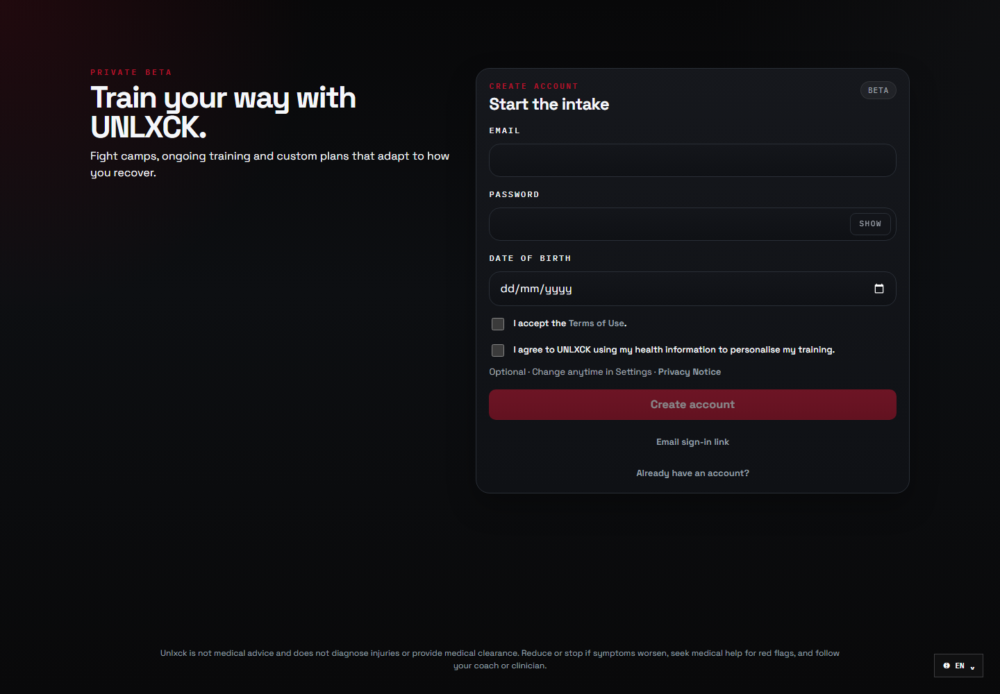
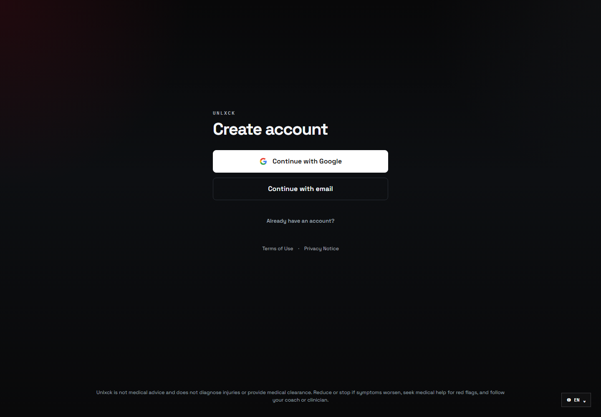
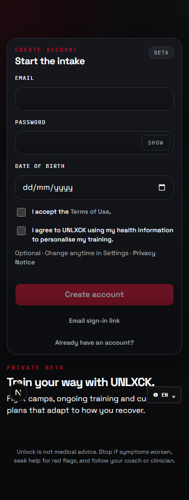
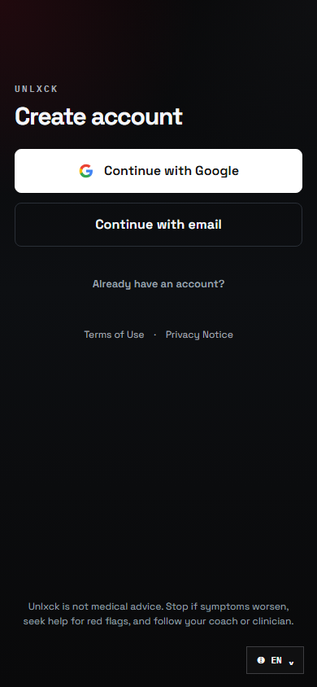

# Google sign-in and authentication UX

Login and signup now open on the same two choices: **Continue with Google** and **Continue with email**. Email reveals the existing form in place. Passwords, magic links, recovery, signup codes, password-manager attributes and Turnstile remain on their existing paths.

## Friction audit

Counts exclude typing keystrokes, provider-owned Google screens, and browser/password-manager interactions. Optional consent is not included in required taps.

| Path | Visible fields before interaction, before → after | Required typing after | Required UNLXCK actions after |
| --- | --- | --- | --- |
| Returning Google athlete | Google unavailable → 0 | None | 1: Google; existing workspace opens after provider authentication |
| New Google athlete | Google unavailable → 0 | DOB only if missing | Google, Terms checkbox, Continue; one existing compliance page only when needed |
| Email login | 2 → 0 | Email and password, or email for magic link | Email reveal + existing submit (one additional reveal tap) |
| Email signup | 3 fields + 2 checkboxes → 0 | Email, password, DOB; confirmation code when configured | Email reveal, Terms, submit, verification submit when required |

Email trades one reveal tap for a much simpler initial decision. No extra email pages were added. Health consent stays unchecked and optional; declining it does not prevent account completion. Returning users are never sent back to consent just because they declined health processing.

## Authentication and age audit

- Supabase's existing browser client uses its implicit flow with `detectSessionInUrl`, persistence and token refresh. Google calls `signInWithOAuth`; its callback lands at the trusted `/login` URL. AuthProvider consumes the session, calls `/api/me`, and the backend's `ensure_profile` resolves or creates the same profile keyed by the verified Supabase user ID.
- The existing `private.enforce_auth_signup_minimum_age` trigger rejects email signups declaring an under-13 DOB but intentionally permits identities without DOB. Google does not establish age. Missing DOB always routes to `/consent`; no DOB or Terms are inferred from Google metadata.
- The backend accepts age evidence only through its existing DOB validation. An under-13 submission returns 403 before writing DOB, Terms or health consent. The profile database trigger also rejects under-13 DOB writes and blocks direct client compliance-column writes. Onboarding and health-feature guards remain server enforced. Protected intake children no longer mount while compliance is unresolved or redirecting.
- **Underage OAuth-created account policy:** preserve the existing refusal behavior. The auth identity may already exist; it remains an incomplete, age-unverified account, not an activated athlete. Show the 13+ refusal, disable continuation, and offer Sign out. A subsequent login returns to missing compliance; no consent is recorded for a rejected underage submission. This change does not silently delete identities, ban accounts or add a retention policy.
- **Age-assurance limit:** DOB is self-declared, as it is for existing email accounts. Rejected DOB values are not persisted, so this is not a durable underage ban and cannot prevent someone from later lying about DOB. Independent age verification or durable refusal/retention rules require a separate product policy and implementation. Google authentication must never be described as age verification.
- Legal and health grants retain server-owned version/timestamp evidence. Health consent uses the existing age-appropriate wording, is never bundled with Terms, and is only sent when explicitly checked. Saving compliance routes from the returned profile, avoiding stale redirects.
- Supabase owns identity linking for verified matching email addresses. The app never links identities by a client-supplied email or creates a separate local Google profile. The automated dual-identity fixture checks routing/session restoration; it does not validate Google's or Supabase's live linking configuration.

## Configuration and verification limits

No environment files, database schema, RLS policies or provider settings changed. Google Cloud and Supabase are already configured per the request. Confirm the deployed `/login` callback is allowed in Supabase Redirect URLs and that the existing `NEXT_PUBLIC_SITE_URL` points at the intended public app. The provider client secret remains in Supabase, never the web bundle.

Automated OAuth tests intercept the authorize endpoint and deliver a Supabase callback session, exercising the actual browser client, session provider, backend response contract and routing. They cover new and returning athletes, dual identities, persisted sessions, consent refusal, underage refusal, callback errors and existing email/recovery regressions. Live Google consent, live identity linking, live CAPTCHA enforcement, and deployed database triggers require a staging check with controlled accounts; no real identities were created during QA.

Browser plugin was not available; the repository's Playwright Chromium workflow was used. Screenshots are rendered local baseline and changed signup screens, not supplied reference images. Viewports: desktop 1440×1000, mobile 390×844.

## Screenshots

| | Before | After |
| --- | --- | --- |
| Desktop |  |  |
| Mobile |  |  |

Provider references: [Google OAuth](https://supabase.com/docs/guides/auth/social-login/auth-google), [identity linking](https://supabase.com/docs/guides/auth/auth-identity-linking).

## Validation results

| Check | Result |
| --- | --- |
| Production build / TypeScript | Pass (`npm run build`; standalone `npm run typecheck` also passed) |
| Frontend unit suite | 2,063 passed |
| Backend auth/compliance regressions | 98 passed; 2 new OAuth age cases passed separately |
| Production browser regressions | 41 passed: Google/email auth, signup codes, recovery, public smoke and accessibility |
| Lint | 0 errors, 51 existing warnings; changed surfaces have only the existing auth-link effect warning |
| Locale catalogs | Pass for every advertised locale |
| Page identity, nonblank screen, framework overlay | Correct signup URL/title, meaningful content, no overlay at both screenshot sizes |
| Render and interaction proof | No page errors or horizontal overflow at 1440×1000 / 390×844; email action reveals the form in place |
| Desktop/mobile visual comparison | Reviewed the baseline and final screenshots; required fields are absent initially and the primary Google action remains prominent |

Reproduce from `web/`: use the repository's CI placeholder public variables for the build (`NEXT_PUBLIC_API_BASE_URL`, `NEXT_PUBLIC_SUPABASE_URL`, `NEXT_PUBLIC_SUPABASE_ANON_KEY`), then run `npm run test:unit`, `npm run lint`, `npm run i18n:check` and `npx playwright test e2e/google-auth.spec.ts e2e/signup-code.spec.ts e2e/auth-links.spec.ts e2e/smoke.spec.ts e2e/accessibility.spec.ts --workers=2`. From the repository root, run `python -m pytest tests/test_compliance_age_and_consent.py tests/test_compliance_consent_schema.py tests/test_auth_service.py -q`.
