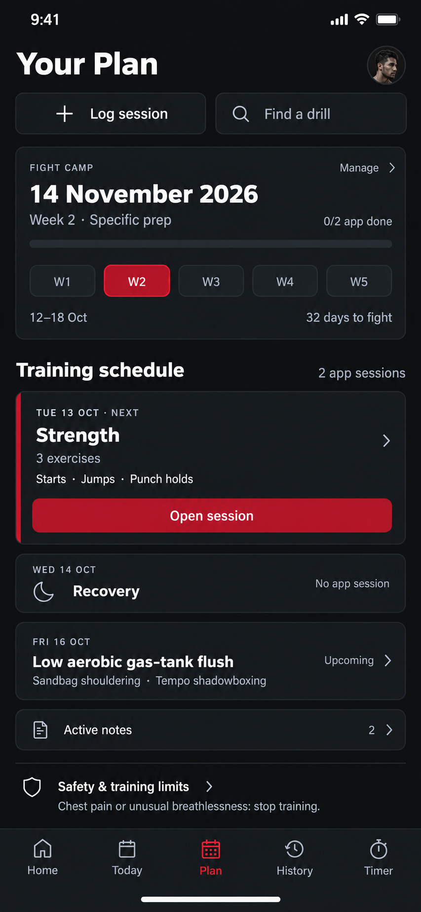
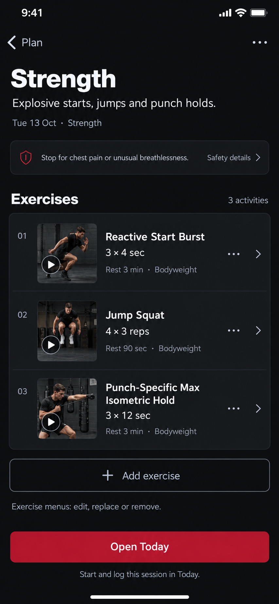
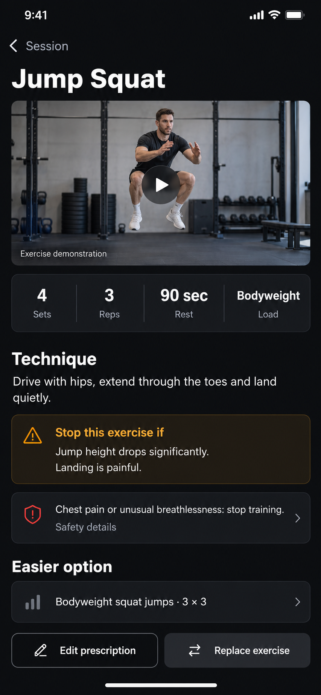

# UNLXCK — Plan, Session and Exercise design review

**Status: proposed direction for review.** These static mockups do not implement product changes. Implementation follows design review.

The three screens share charcoal surfaces, confident typography, restrained deep red and deliberate information grouping. Existing workout prescriptions and safety restrictions remain authoritative.

## Plan overview

One camp surface combines phase, week selection and progress. The next session gets the primary action, upcoming training is quieter, and recovery stays compact.

## Session detail

An ordered exercise list combines demonstration thumbnails with exact prescriptions and exercise-management menus. Open Today leads to the existing session execution controls.

## Exercise detail

Demonstration leads, followed by a single prescription band, technique, local and global stop guidance, an easier option and supported editing actions.

## Review scope

Assess visual hierarchy, information density, action clarity, consistency, mobile composition and repetition across all three screens. These are primary-screen concepts, not exhaustive permission or state specifications.

Exercise data is grounded in existing coaching fixtures. Demonstration images are generated illustrations of the intended media treatment; actual implementation must use only valid resolved demonstration media. Camp dates and account states form a review scenario, not a live account snapshot.

[Detailed design decisions, source data and limitations](design-review.md)
